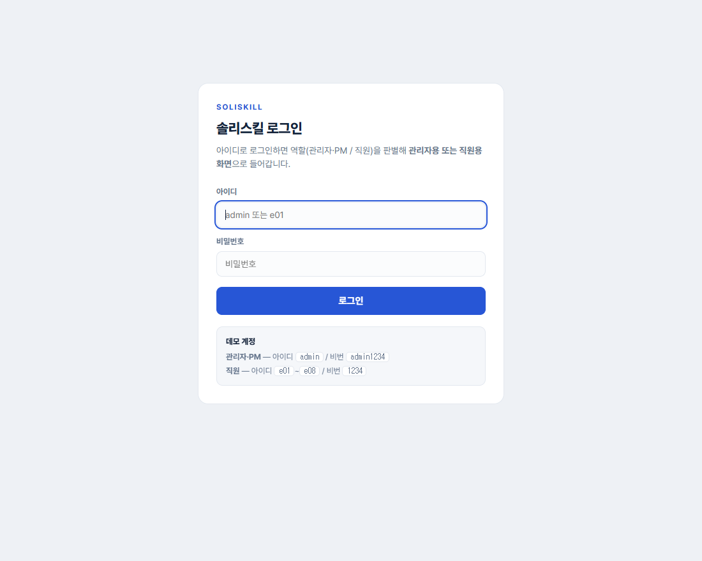
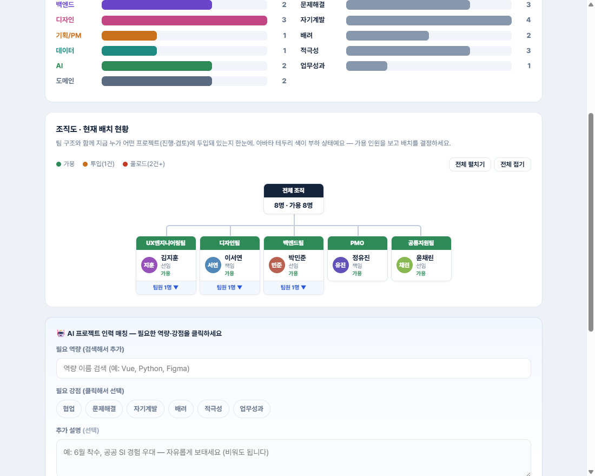
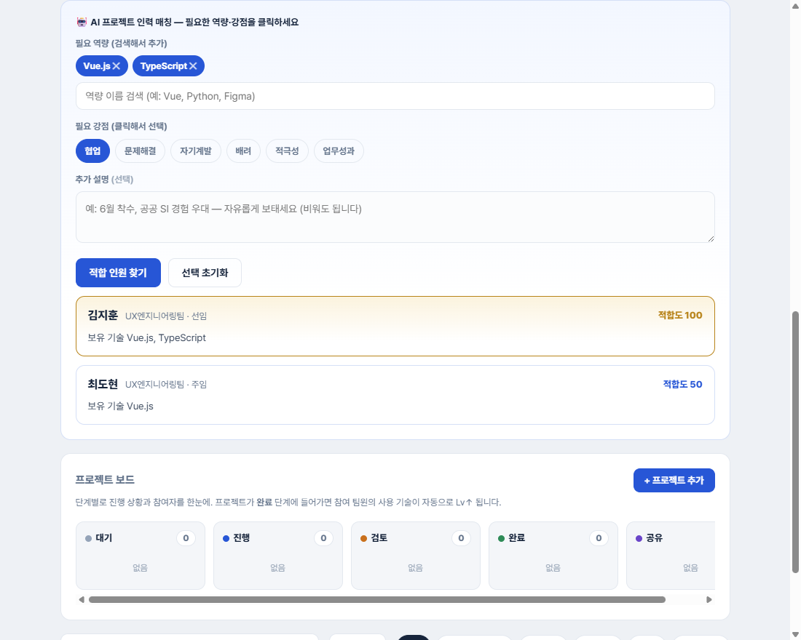
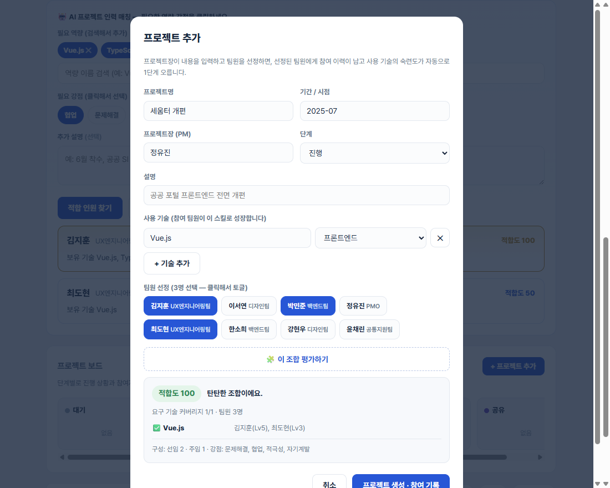
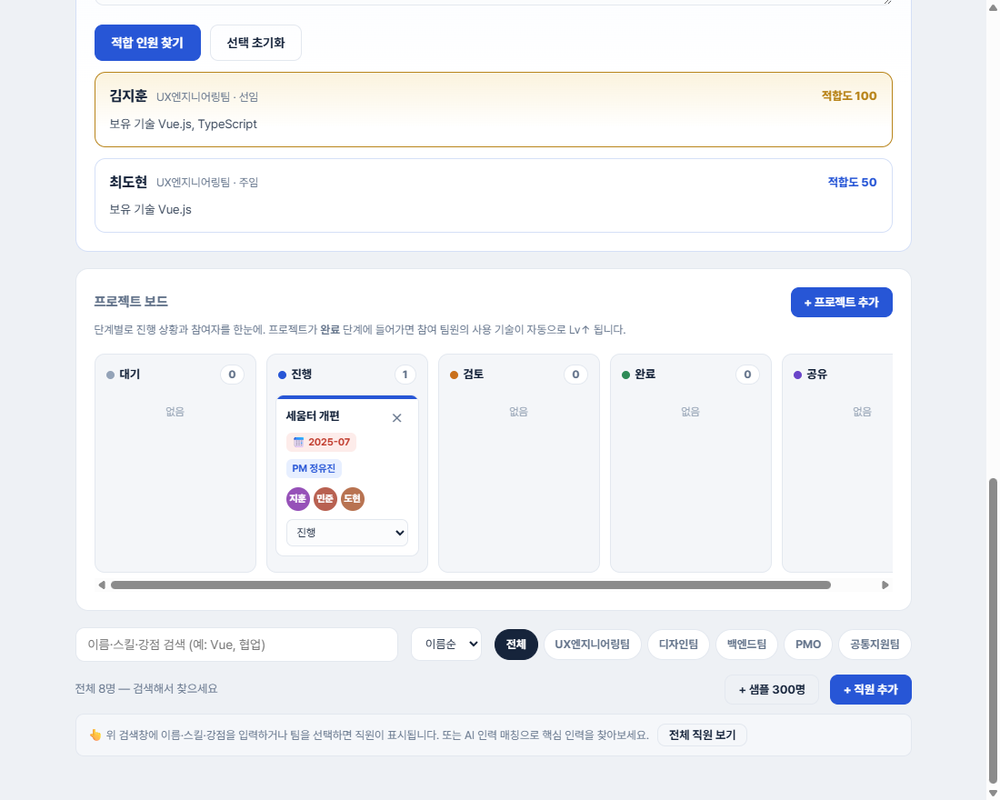

# 솔리스킬 (SoliSkill) — 조직 역량 인벤토리 + AI 인력 매칭

> 직원 개개인의 역량을 데이터로 모아 **조직 전체의 역량 분포를 한눈에 보고**, 프로젝트에 맞는 인원을 **AI가 추천**하며, **프로젝트 참여 → 역량 성장**이 자동으로 기록되는 사내 역량 관리 데모.

**한 줄 소개** — "우리 회사에 이 일 잘하는 사람 누구지?"를 검색 한 번으로 답하고, 프로젝트가 끝나면 역량이 저절로 자라는 사내 역량 플랫폼.

- 해커톤용 **화면 전용 시뮬레이션**입니다 (DB·백엔드 없음 — 브라우저 localStorage로 동작)
- 솔리데오 **실제 조직 구조** 기반: 정직원 252명 · 협력 79명 · 대표이사→총괄/중부지사→본부→팀 계층
- React 19 + Vite

## 미리보기

| 로그인 (역할 분기) | 조직도 · 배치 현황 |
|---|---|
|  |  |

| AI 인력 매칭 | 조합 평가 |
|---|---|
|  |  |

| 프로젝트 칸반 보드 | |
|---|---|
|  | |

---

## 발표 자료

`presentation/` 폴더를 통째로 사용합니다 — `2_내가읽을것_대본.html`(대본·타이머)과 `1_화면에띄울것_발표화면.html`(장표 15장)을 열면 서로 연결되어 대본 시간에 맞춰 장표가 넘어갑니다. 사용법은 `presentation/자료/0_먼저읽기_발표순서.txt`.

## 1. 실행 방법

```bash
npm install
npm run dev   # http://localhost:5173
```

**데모 계정**

| 역할 | 아이디 | 비밀번호 | 비고 |
|---|---|---|---|
| 관리자·PM | `admin` | `admin1234` | 우덕성 팀장(중부지사) — 전 화면 접근 |
| 직원 | `r177`(박선우·중부지사) `r175`(윤승미·중부지사) 등 직원 ID | `1234` | 마이페이지·우리 팀 보드(참여중·협업 표시) |

- 로그인 화면의 **🔄 데모 데이터 초기화** 버튼으로 언제든 초기 시연 상태로 복구
- (선택) AI 매칭·이력서 자동 채우기에 실제 Claude를 쓰려면 `.env`에 `ANTHROPIC_API_KEY` 설정 — 키가 없으면 **규칙 기반으로 자동 폴백**되며 결과에 "📐 규칙 기반" 배지로 표시됩니다

## 2. 프로그램 취지

회사가 커질수록 "**누가 무엇을 잘하는지**"가 흩어집니다.

| 문제 | 솔리스킬의 해법 |
|---|---|
| 적합 인원을 일일이 수소문 | **AI 인력 매칭** — 필요 역량·강점으로 적합도 순 추천 + 가용성(투입/풀로드) 표시 |
| 역량이 이력서·머릿속에만 존재 | **역량 인벤토리** — 스킬·숙련도(Lv1~5)·출처·강점·교육·프로젝트 구조화 |
| 실력이 늘어도 갱신이 번거로움 | **프로젝트 완료 → 참여자 스킬 자동 Lv↑** + 역량 개발 기록 |
| 역량 정보의 민감성 | **역할 기반 접근** — 직원은 본인만, 관리자는 열람 가능 · 공개 여부는 **본인만 변경** |

## 3. 화면 구성 (좌측 사이드바 4메뉴)

| 메뉴 | 대상 | 내용 |
|---|---|---|
| **마이페이지** | 전체 | 내 프로필(사진·이메일·내선)·강점·스킬 바·교육/프로젝트 이력·역량 개발 기록 · 역량 공개 스위치 |
| **조직도** | 전체† | 실제 조직 트리(대표이사→총괄/지사→본부→팀→인원, 협력 태그) · 검색 · 직급순 정렬 · 인원별 가용/투입/풀로드 상태 · **사람 클릭 → 역량 보기** |
| **조직 역량** | 전체† | 분야·강점 분포 차트 + **인사이트 한 줄**("가장 얇은 분야 보강 검토") · 본부/팀 필터 연동 · 직원 검색(직급순) · 직원 추가/수정(이력서 AI 자동 채우기) |
| **프로젝트 보드** | 전체* | AI 인력 매칭 → **"이 N명으로 프로젝트 만들기"** 원클릭 배정 · 5단계 칸반(대기/진행/검토/완료/공유) · 카드 클릭 → 상세 팝업(팀원·기술·수정/삭제) · **완료 시 참여자 스킬 자동 성장(토스트 알림)** |

*직원은 자신이 참여한 프로젝트만 보임. AI 매칭·수정/삭제는 관리자 전용.
†직원도 조직 구조·분포 차트는 볼 수 있지만, 사람 클릭 → 개인 역량 보기와 직원 목록·추가/수정은 관리자 전용.

## 4. 핵심 데모 동선 🎤

1. **조직도**에서 인원 검색 → 클릭 → 역량 확인
2. **프로젝트 보드**에서 필요 역량 선택(Enter로 추가) → **적합 인원 찾기** — 적합도·가용성과 함께 추천
3. 결과 하단 **"이 3명으로 프로젝트 만들기"** → 인원·기술이 채워진 모달 → 저장
4. 칸반에서 단계 이동 → **완료** 순간 "✓ 팀원 N명의 스킬이 성장했어요 ▲" 토스트
5. **조직 역량** 분포에 성장분이 반영 — 순환 완성

## 5. 데이터 (화면 전용)

| 파일/키 | 내용 |
|---|---|
| `src/roster.json` | 정직원 252명 — 실제 명단 기반, 팀·직급 기반 스킬 자동 생성(추정치) |
| `src/orgtree.json` | 실제 조직도 트리 (협력 79명 포함, 협력은 역량·매칭 대상 제외) |
| `localStorage: skillmap.emps.v10` | 직원 데이터 (추가·수정분 유지) |
| `localStorage: skillmap.projects.v4` | 프로젝트 (첫 실행 시 시연용 시드 12건 — 본사 6 · 중부지사 6) |
| `localStorage: skillmap.auth / savedid` | 자동 로그인 · 아이디 저장 |

**적합도 기준**: 요구 항목별 점수의 평균 — 보유 기술 = 60 + 숙련도×8(항목당 최고 100), 강점 일치 = 100, 미보유 = 0. 매칭 결과 위 "ⓘ 적합도는 어떻게 계산되나요?"에 공개되고 카드마다 계산식이 표시됨. 60·8·100은 팀이 정한 초기값으로, 관리자가 화면에서 조정 가능(브라우저에 저장, 데모 데이터 초기화 시 복원). AI 모드에서도 점수는 이 공식으로 계산(AI는 후보·추천 이유만).

**프라이버시**: AI 매칭 시 이름·연락처·내부 ID는 외부로 전송하지 않음 — 요청마다 순서를 섞어 새로 만든 **일회용 익명 ID**(P1, P2…)와 역량만 보내고, 응답은 그 요청의 대응표로만 화면에서 실명 복원(요청 간 동일인 추적 불가).

## 6. 폴더 구조

```
skillmap/
├─ public/
│  ├─ favicon.svg              # 솔리데오 브랜드 파비콘
│  ├─ solideo-logo.png         # 컬러 CI (사이드바)
│  └─ solideo-logo-white.png   # 흰색 CI (로그인 패널)
├─ src/
│  ├─ App.jsx                  # 앱 전체 (페이지·상태·스타일)
│  ├─ roster.json              # 직원 데이터
│  ├─ orgtree.json             # 조직도 트리
│  └─ main.jsx
├─ vite.config.js              # /api/messages → Anthropic 프록시 (키는 서버측 주입)
└─ .env.example                # ANTHROPIC_API_KEY 템플릿
```

## 7. 기술 메모

- **스택**: React 19, Vite 8, 단일 컴포넌트 + 인라인 스타일시트 (데모 최적화 구조)
- **AI**: Claude API (Vite dev 프록시 경유, 키 미설정 시 규칙 기반 폴백 + 출처 배지)
- **UX**: 삭제 확인 팝업 · 행동 토스트(저장/성장/삭제) · ESC 닫기 · 페이지 전환 스크롤 리셋 · 가로 스크롤 없음
- **접근성**: 로그인 폼 label/autocomplete, 상태 색상+텍스트 병기(색각 대응), `role="switch"`
